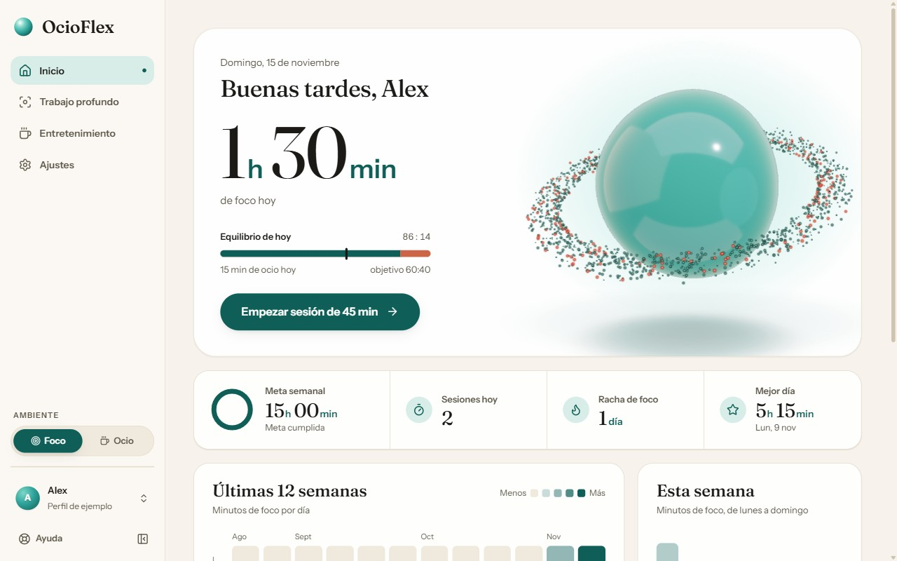

# OcioFlex

**Focus and leisure, in balance.** A Windows desktop app (Tauri 2 + Next 16 static export) that times deep-work blocks, keeps rest honest, and reads your week back to you. "Paper & Tide" design: warm ivory paper, a **Foco** mood (deep teal) and an **Ocio** mood (apricot/coral) that cross-fade the whole canvas, and a procedural 3D Tide Orb.



## Features

- **Cinematic start**: ~3 s splash (particles converge into the Tide Orb, the wordmark softens in), skippable after 0.8 s with any key or click. Then the orb settles onto the sign-in stage, or straight into Home when a remembered session is valid.
- **Local accounts**: sign in or create an account (username or email), password strength meter, show/hide, "keep me signed in" for 30 days, lockout after 5 failed attempts (30 s, then 60 s, …), change password, delete account. Also **Explore with a sample profile** (two weeks of example activity, no typing).
- **First-run questionnaire** (8 short steps, each skippable) that sets your default session length, weekly goal, balance target, break ideas and quick-launch shortcuts. Editable any time in Settings → Profile.
- **Tutorial**: a 7-step coach-mark tour after the questionnaire. Replay it from **Tour** in the sidebar or Settings → Profile.
- **Home**: greeting by name, today's focus time, today's balance against your target, a weekly-goal ring, streak, best day, a 12-week heatmap and this week's bars. The 3D orb's ring shows today's focus:leisure split.
- **Deep Work** timer (25/45/60/90), **Entertainment** rest timer and editable quick-launch shortcuts.
- **Flex**, the assistant: **Task Splitter**, **Break Suggester** and **Analyse my week**.
- Spanish and English everywhere, chosen before sign-in too.

## Accounts are local

There is **no server and no cloud sync**. Accounts live only on this computer:

- Passwords are hashed with **Argon2id** (per-user random salt) by the Rust core. The hashes are written to `%APPDATA%\digital.vicardev.ocioflex\auth\users.json`, a file the interface has no way to read.
- "Keep me signed in" stores a random 256-bit token on the device; the account file keeps only its SHA-256.
- Each user's data (sessions, shortcuts, profile, running timer) lives in `users/<id>/ocioflex.json` under the same folder.
- A forgotten password can't be reset by email (there is none). The sign-in screen offers to **delete that profile and start over**, with a typed confirmation.

## Flex: assistant modes

| Mode | When | What happens |
|---|---|---|
| **Local assistant** (default) | No API key configured | Answers are built on this computer from your own sessions and profile. Real numbers, no network. |
| **Connected to Gemini** | A key is configured | Requests go to Google Gemini (`gemini-flash-latest`, override with `AI_MODEL`). If Gemini fails, Flex answers locally and says so. |

The current mode is shown as one line in **Settings → Assistant**, next to the key field and **Test connection**.

### Adding a Gemini key (optional)

Get a free key at <https://aistudio.google.com>, then use any one of these (checked in this order):

1. **In the app**: Settings → Assistant → paste the key → *Save key* → *Test connection*. The Rust core stores it in the app config folder. The interface only ever learns "configured: yes/no".
2. **Environment** variables `AI_PROVIDER=gemini`, `AI_API_KEY=…`, `AI_MODEL=…`, or a `.env` file next to `OcioFlex.exe`.
3. **Development only**: a `.env` at the repo root (copy `.env.example`; `.env` is git-ignored).

### Privacy: what Gemini receives

Only aggregated statistics (minutes per day, streak, best hour, goal progress) and the non-personal parts of your profile (occupation, rhythm, goals, obstacles, leisure tastes, session length). **Never** your name, username, email or password. The Rust core strips those fields again before sending, as a second line of defence. The key travels only in the `x-goog-api-key` header and is never logged.

## Run and build

```bash
npm install
npm run tauri dev        # desktop app in development
npm run dev              # browser-only review: auth, data and Flex are shimmed (WebCrypto PBKDF2, localStorage)
npm run tauri build      # installers in src-tauri/target/release/bundle/{nsis,msi}
```

Requirements: Node 20+, Rust 1.90+, Windows 10/11. The installer embeds the WebView2 bootstrapper; on a machine without WebView2 it may still need internet once to install it.

Checks: `npm run lint`, `npx tsc --noEmit`, `cd src-tauri && cargo test` (auth, assistant, Gemini fixtures), `node scripts/contrast.mjs` (every text/background pair ≥ 4.5:1).

## Install

Run `OcioFlex_1.0.0_x64-setup.exe` (per-user, Spanish or English installer) or `OcioFlex_1.0.0_x64_en-US.msi`. Publisher: VICAR. Identifier: `digital.vicardev.ocioflex`.

## Demo script (about 3 minutes)

1. **Launch**: watch the splash (particles → orb → wordmark, teal to coral and back). Press any key to skip on a second launch.
2. **Explore with a sample profile**: the orb bursts into Home. Point out the greeting, the balance bar against its target, the weekly-goal ring, and the orb ring that shows today's split.
3. **Switch language and mood**: ES/EN in Settings → Language & mood; flip Foco ↔ Ocio in the sidebar and watch the canvas and orb cross-fade.
4. **Timer**: Deep Work → start a 45-min block. It keeps running in the sidebar card, and after closing and reopening the app.
5. **Flex**: on Deep Work write "leer el capítulo 3, hacer el resumen y preparar preguntas" → *Split into blocks* → *Use* a block. On Entertainment pick a mood → *Suggest a break*. On Home → *Analyse my week*.
6. **First run**: sign out (sidebar user menu), *Create account*, go through the questionnaire and the tour; Settings → Profile → *Retake questionnaire* / *Replay tour*.

## Design

See `docs/OCIOFLEX_PLAN.md`. Fonts: Fraunces (display; its SOFT axis follows the mood) and Instrument Sans (UI), both bundled. Screens: `docs/screens/{es,en}/`.

Credits: `CREDITS.md`.
